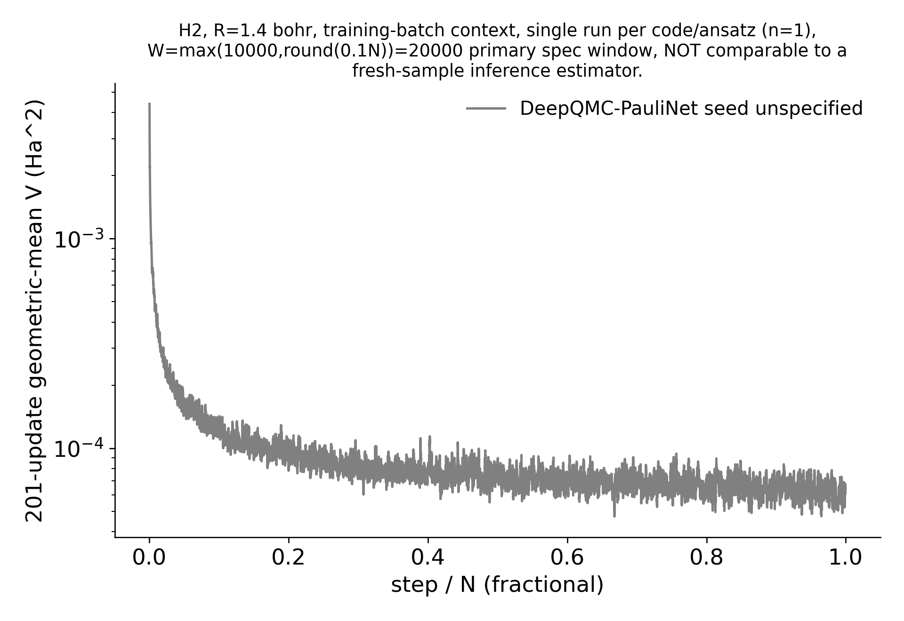

# Stage-1 baseline report: He, H2, and H

Scope: the accepted BL-R2 baseline corpus only. Values below are copied from the hash-bound CSVs in `stage1-report/`; no new run or test was performed. The common tail rule is `W=max(10000, round(0.1N))`; where a secondary window is shown, it is labelled explicitly. `training_tail` is the estimator unless labelled `inference`.

## He

Reference: `systems.yaml` He id `He`, E0 = -2.903724377034119598 Ha. Source table: `he-canonical-f8.csv` (SHA256 `6a12daa399557075453f766b7c8d4380a70b93f3c2493d963d1b9cb205ae1f59`). The rows are historical corpus records; they are not TPEN runs. The Orbformer row is `inference`; all other rows here are `training_tail`.

| code / ansatz | run id | code commit | seed | N | W | E_W (Ha) | blocked SE | delta (uHa) | stage-1 |
|---|---|---|---|---:|---:|---:|---:|---:|---|
| DeepQMC / deeperwin | R01 | edf373e7 | unrecorded | 20000 | 10000 | -2.903722517562 | 4.779e-06 | +1.859 | record-only |
| DeepQMC / default | R02 | edf373e7 | unrecorded | 20000 | 10000 | -2.903686363435 | 1.603e-05 | +38.014 | record-only |
| DeepQMC / ferminet | R03 | edf373e7 | unrecorded | 20000 | 10000 | -2.903718433475 | 3.840e-06 | +5.944 | record-only |
| DeepQMC / lapnet | R04 | edf373e7 | unrecorded | 20000 | 10000 | -2.903720249772 | 3.212e-06 | +4.127 | record-only |
| DeepQMC / psiformer | R05 | edf373e7 | unrecorded | 20000 | 10000 | -2.903723219585 | 3.169e-06 | +1.157 | record-only |
| DeepQMC / transpsiformer | R06 | edf373e7 | unrecorded | 20000 | 10000 | -2.903721802950 | 2.284e-06 | +2.574 | record-only |
| Neural Pfaffian / neural_pfaffian | R13 | f711f08a | 813784688 | 100000 | 25000 | -2.903723855906 | 5.72e-07 | +0.521 | record-only |
| OneQMC / orbformer-se | R14 | b7ed7223 | 42 | 40000 | 10000 | -2.903742715096 | 1.151e-05 | -18.338 | record-only; inference |
| FermiNet / psiformer | R15 | c4312c31 | 23 | 200000 | 20000 | -2.903727148790 | 2.732e-06 | -2.772 | record-only |
| FermiNet / ferminet | R16 | c4312c31 | 23 | 200000 | 20000 | -2.903717802725 | 2.737e-06 | +6.574 | record-only |

The available He trajectory curves are descriptive only: `he-curve-series-table.csv` (SHA256 `6b4e26db5894705b9398333d599e00c7594e52fb3b8efc45955f0ebf6139a60e`). They do not establish a common optimizer-step criterion for every historical row, so the per-row Stage-1 field is `record-only`. Figure: .

## H2

Reference: `systems.yaml` H2 id `H2`, E0 = -1.17447 Ha; the source records the reference rounded to ±5 uHa. Source table: `h2-combined-table-r2.csv` (SHA256 `2f2f76041d5c41e0a48307ad531a77b4ed40c411a9a9f9c9154827d252436100`). These are historical baseline records, not TPEN values.

| code / ansatz | run id | code commit | seed | N | W | E_W (Ha) | blocked SE | delta (uHa) | stage-1 |
|---|---|---|---|---:|---:|---:|---:|---:|---|
| DeepQMC / default (PauliNet-native) | dqmc-paulin2-h2-fix-39520283 | edf373e7 | unrecorded | 200000 | 20000 | -1.174469784546 | 4.665e-06 | +0.215 | record-only |
| DeepQMC / default (secondary record window) | dqmc-paulin2-h2-fix-39520283 | edf373e7 | unrecorded | 200000 | 50000 | -1.174470104489 | 2.941e-06 | -0.104 | record-only |
| FermiNet-codebase / ferminet | r2-h2-39068280 | c4312c31 | 23 | 200000 | 20000 | -1.174474339240 | 8.631e-07 | -4.339 | record-only |
| FermiNet-codebase / psiformer | psi-2e-39195983__H2 | c4312c31 | 23 | 200000 | 20000 | -1.174469850475 | 1.495e-06 | +0.150 | record-only |

Figure: . No TPEN overlay is present.

## H

Reference: `systems.yaml` H id `H`, E0 = -0.5 Ha. Source table: `h-rows-table.csv` (SHA256 `db52af473f5a7b421e5dd85911d465bcbbfbf18c2f6eb14b037387cc22edfa4c`). The full runs are explicitly non-science (`SCIENCE=false`) and are training-batch trajectories, not fixed-parameter inference estimates and not comparable to a future fresh-sample preregistration verdict.

| code | seed | N | W | E_W (Ha) | blocked SE | delta (uHa) | mean V | SE(mean V) | median V [95% CI] | rms/median sigma | max/median V | rebound | stage-1 |
|---|---:|---:|---:|---:|---:|---:|---:|---:|---|---:|---:|---:|---|
| FermiNet | 0 | 50000 | 10000 | -0.499999681196 | 2.661e-07 | +0.319 | 2.755e-06 | 1.686e-08 | 2.646e-06 [2.633e-06,2.662e-06] | 1.020 | 14.587 | 1.027 | loss/finite/variance reduced |
| FermiNet | 1 | 50000 | 10000 | -0.499999814633 | 3.469e-07 | +0.185 | 4.048e-06 | 1.877e-08 | 3.944e-06 [3.928e-06,3.962e-06] | 1.013 | 3.174 | 1.007 | loss/finite/variance reduced |
| FermiNet | 2 | 50000 | 10000 | -0.499999395626 | 5.391e-07 | +0.604 | 8.327e-06 | 1.415e-07 | 6.226e-06 [6.177e-06,6.279e-06] | 1.157 | 42.184 | 1.032 | loss/finite/variance reduced |
| Psiformer | 0 | 30000 | 10000 | -0.500000176363 | 7.326e-07 | -0.176 | 1.161e-05 | 6.680e-07 | 3.381e-06 [3.304e-06,3.473e-06] | 1.853 | 835.103 | 1.348 | loss/finite/variance reduced |
| Psiformer | 1 | 30000 | 10000 | -0.499999443732 | 3.417e-07 | +0.556 | 3.582e-06 | 2.072e-07 | 1.561e-06 [1.546e-06,1.576e-06] | 1.515 | 770.439 | 1.015 | loss/finite/variance reduced |
| Psiformer | 2 | 30000 | 10000 | -0.499999212663 | 8.988e-07 | +0.787 | 1.916e-05 | 1.395e-06 | 3.945e-06 [3.792e-06,4.092e-06] | 2.204 | 2076.429 | 1.338 | loss reduced/finite; variance reduced first→mid, flat/ambiguous mid→last |

The six full H rows have finite values and reduced loss; variance decreases from first-to-mid blocks for all six, while the short mid-to-last comparison is reduced for five of six (Psiformer seed 2 is effectively flat/ambiguous). The post-hoc late-rise ratio has the argmin caveat: the rolling-median minimum is inside the final-10% numerator window for all six rows, so it is not evidence of a rise beyond the direct block comparison. Figure: .

## Firewall and interpretation

Hooke is skipped: there is no native baseline support. F-sigma, P-sigma, F-abserr, and P-abserr are intentionally absent because they contain a TPEN pilot overlay. No TPEN values, columns, or figures are included here. Historical He/H2 corpus status and H `SCIENCE=false` status remain labels, not science claims. Training-batch context must not be compared to a fresh-sample H-v2 preregistration verdict.

## Source trace

| content | source |
|---|---|
| He energies, references, estimator, N/W, code/seed metadata | TO `19fcf084`, notes `sota-context-critical-analysis-20261117` and `-partB/-C/-D`; hash-bound `he-canonical-f8.csv` above |
| H2 rows and ±5 uHa reference rounding | TO `19fcf084`, note `stage1-h2-rows-20261119-r2`; hash-bound `h2-combined-table-r2.csv` above |
| H rows, VARERR/F11 fields, Stage-1 criteria | TO `19fcf084`, note `sota-context-critical-analysis-20261117-r2-H`; TO `dc036f76`, notes `run-conclusions-full-20261119`, `run-conclusions-full-20261119-partB`, and assessment; hash-bound `h-rows-table.csv` above |
| late-rise argmin caveat | TO `19fcf084`, note `sota-context-critical-analysis-20261117-r2-H-addendum-argmin`, SHA256 `1f137bf189e185750a197c1296155101eb518d06f2386888d5b51709713fd645` |
| figures and curve table | Preserved source directories listed in the acceptance contract; copied byte-for-byte and listed in `stage1-report/SHA256SUMS` |
