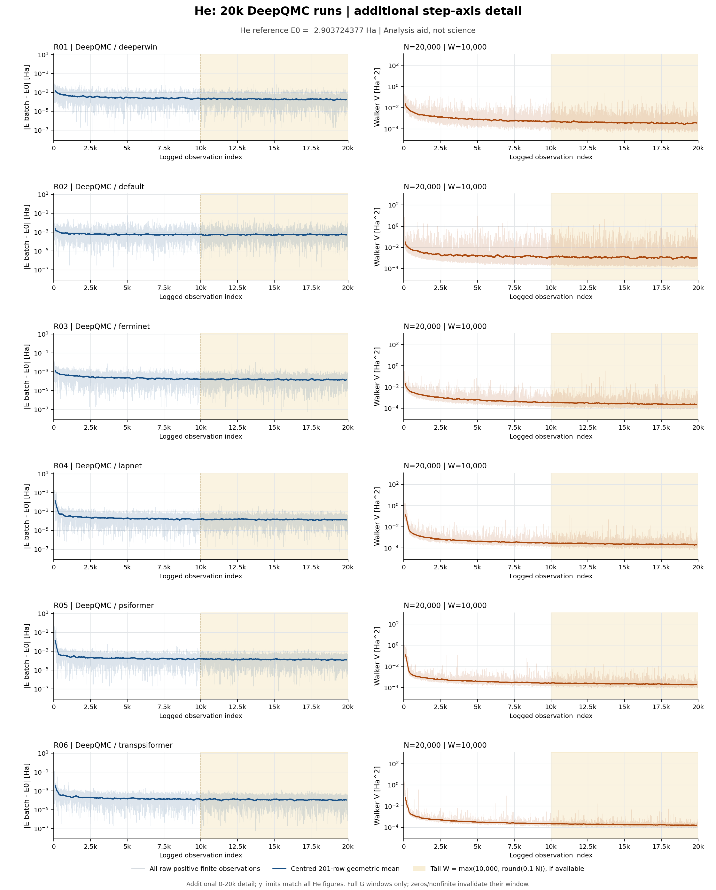
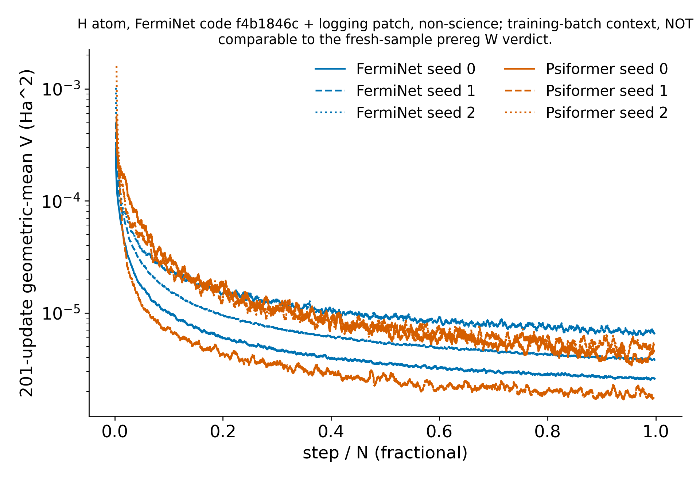

# Stage-1 baseline report: He, H2, and H

Scope: the accepted BL-R2 baseline corpus only. Values below are copied from the hash-bound CSVs in `stage1-report/`; no new run or test was performed. The common tail rule is `W=max(10000, round(0.1N))`; where a secondary window is shown, it is labelled explicitly. `training_tail` is the estimator unless labelled `inference`.

## He

Reference: `systems.yaml` He id `he_atom`, E0 = -2.903724377034119598 Ha. Source table: `he-canonical-f8.csv` (SHA256 `6a12daa399557075453f766b7c8d4380a70b93f3c2493d963d1b9cb205ae1f59`); the joined JSON source is `canonical-f8.json` (SHA256 `27f089b04cb7bca4af02ab560bb132526d6896e2786d3fb729bcadefc1dc1601`). The rows are historical corpus records; they are not TPEN runs. The Orbformer row is `inference`; all other rows here are `training_tail`.

| code / ansatz | run id | code commit | seed | N | W | E_W (Ha) | blocked SE | delta (uHa) | mean V +/- blocked SE | median V [95% CI] | stage-1 |
|---|---|---|---|---:|---:|---:|---:|---:|---|---|---|
| DeepQMC / deeperwin | R01 | edf373e7 | unrecorded | 20000 | 10000 | -2.903722517562 | 4.779e-06 | +1.859 | 8.785e-04 +/- 3.970e-05 | 3.343e-04 [3.272e-04,3.428e-04] | loss/finite/variance reduced |
| DeepQMC / default | R02 | edf373e7 | unrecorded | 20000 | 10000 | -2.903686363435 | 1.603e-05 | +38.014 | 9.784e-03 +/- 9.909e-04 | 7.535e-04 [7.251e-04,7.841e-04] | loss/finite/variance reduced |
| DeepQMC / ferminet | R03 | edf373e7 | unrecorded | 20000 | 10000 | -2.903718433475 | 3.840e-06 | +5.944 | 5.095e-04 +/- 4.682e-05 | 2.317e-04 [2.272e-04,2.363e-04] | loss/finite/variance reduced |
| DeepQMC / lapnet | R04 | edf373e7 | unrecorded | 20000 | 10000 | -2.903720249772 | 3.212e-06 | +4.127 | 3.312e-04 +/- 2.208e-05 | 2.101e-04 [2.074e-04,2.134e-04] | loss/finite/variance reduced |
| DeepQMC / psiformer | R05 | edf373e7 | unrecorded | 20000 | 10000 | -2.903723219585 | 3.169e-06 | +1.157 | 2.840e-04 +/- 7.888e-06 | 2.017e-04 [1.990e-04,2.044e-04] | loss/finite/variance reduced |
| DeepQMC / transpsiformer | R06 | edf373e7 | unrecorded | 20000 | 10000 | -2.903721802950 | 2.284e-06 | +2.574 | 1.953e-04 +/- 4.067e-06 | 1.733e-04 [1.712e-04,1.753e-04] | loss/finite/variance reduced |
| DeepQMC / deeperwin | R07 | edf373e7 | unrecorded | 188894 | 18889 | -2.903723506439 | 2.027e-06 | +0.871 | 3.168e-04 +/- 1.290e-05 | 1.010e-04 [9.911e-05,1.028e-04] | loss/finite/variance; mid->last not reduced |
| DeepQMC / default | R08 | edf373e7 | unrecorded | 100000 | 50000† | -2.903709089837 | 7.201e-06 | +15.287 | 1.167e-02 +/- 1.340e-03 | 5.645e-04 [5.427e-04,5.901e-04] | loss/finite/variance reduced |
| DeepQMC / default | R09 | edf373e7 | unrecorded | 200000 | 50000‡ | -2.903716541128 | 7.963e-06 | +7.836 | 1.628e-02 +/- 3.593e-03 | 5.205e-04 [5.049e-04,5.398e-04] | loss/finite/variance reduced |
| DeepQMC / lapnet | R10 | edf373e7 | unrecorded | 100204 | 10020 | -2.903730758721 | 6.935e-06 | -6.382 | 1.760e-03 +/- 1.569e-03 | 1.159e-04 [1.145e-04,1.172e-04] | loss/finite/variance reduced |
| DeepQMC / lapnet | R11 | edf373e7 | unrecorded | 200000 | 20000 | -2.903720270610 | 1.318e-06 | +4.106 | 1.403e-04 +/- 3.420e-06 | 8.694e-05 [8.609e-05,8.770e-05] | loss/finite/variance reduced |
| Neural Pfaffian / neural_pfaffian | R13 | f711f08a | 813784688 | 100000 | 25000 | -2.903723855906 | 5.72e-07 | +0.521 | record-only mean V; no VARERR SE (2.474e-05 Ha²) | unavailable: no restored raw series | record-only |
| OneQMC / orbformer-se | R14 | b7ed7223 | 42 | 40000 | 10000 | -2.903742715096 | 1.151e-05 | -18.338 | record-only mean V; no VARERR SE (1.196e-03 Ha²) | unavailable: no restored raw series | record-only; inference |
| FermiNet / psiformer | R15 | c4312c31 | 23 | 200000 | 20000 | -2.903727148790 | 2.732e-06 | -2.772 | no walker variance | no walker variance | loss reduced, finite; no V logged |
| FermiNet / ferminet | R16 | c4312c31 | 23 | 200000 | 20000 | -2.903717802725 | 2.737e-06 | +6.574 | no walker variance | no walker variance | loss reduced, finite; no V logged |

The Stage-1 fields are computed from `stage1-criteria-he-h2.csv` (SHA256 `65403385cde6390963e3393237bea42118159ffe96f7185ee78f794e057bf5c5`). For He/H2, “loss reduced” means reduced mean absolute reference error, last100 versus first100. Blocks are observations `[0,100)`, `[N//2,N//2+100)`, and `[N-100,N)`. Variance compares block means first→mid and mid→last separately; finite means zero nonfinite logged E/V over the full series, with V assessed only where available. These are descriptive block checks, not convergence or monotonic-loss tests. H uses the same first/mid/last-100 block method, with the Psiformer seed-2 qualification stated below. The available He trajectory curves are descriptive only: `he-curve-series-table.csv` (SHA256 `6b4e26db5894705b9398333d599e00c7594e52fb3b8efc45955f0ebf6139a60e`). Figure: .

† R08 energy columns use the record window W=50000; its variance columns use the spec window W=max(10000,round(0.1N))=10000. ‡ R09 energy columns use the record window W=50000; its variance columns use the spec window W=max(10000,round(0.1N))=20000. No other He row has an energy/variance window mismatch.

## H2

Reference: `systems.yaml` H2 id `h2_molecule`, E0 = -1.17447 Ha; the source records the reference rounded to ±5 uHa. Source table: `h2-combined-table-r2.csv` (SHA256 `2f2f76041d5c41e0a48307ad531a77b4ed40c411a9a9f9c9154827d252436100`). These are historical baseline records, not TPEN values.

| code / ansatz | run id | code commit | seed | N | W | E_W (Ha) | blocked SE | delta (uHa) | stage-1 |
|---|---|---|---|---:|---:|---:|---:|---:|---|
| DeepQMC / default (PauliNet-native) | dqmc-paulin2-h2-fix-39520283 | edf373e7 | unrecorded | 200000 | 20000 | -1.174469784546 | 4.665e-06 | +0.215 | loss/finite/variance reduced |
| DeepQMC / default (secondary record window) | dqmc-paulin2-h2-fix-39520283 | edf373e7 | unrecorded | 200000 | 50000 | -1.174470104489 | 2.941e-06 | -0.104 | loss/finite/variance reduced |
| FermiNet-codebase / ferminet | r2-h2-39068280 | c4312c31 | 23 | 200000 | 20000 | -1.174474339240 | 8.631e-07 | -4.339 | loss reduced, finite; no V logged |
| FermiNet-codebase / psiformer | psi-2e-39195983__H2 | c4312c31 | 23 | 200000 | 20000 | -1.174469850475 | 1.495e-06 | +0.150 | loss reduced, finite; no V logged |

Figure: . No TPEN overlay is present.

## H

Reference: `systems.yaml` H id `h_atom`, E0 = -0.5 Ha. Source table: `h-rows-table.csv` (SHA256 `db52af473f5a7b421e5dd85911d465bcbbfbf18c2f6eb14b037387cc22edfa4c`). The full runs are explicitly non-science (`SCIENCE=false`) and are training-batch trajectories, not fixed-parameter inference estimates and not comparable to a future fresh-sample preregistration verdict. H provenance: FermiNet seeds 0–2 are PBS 7858872; Psiformer seeds 0–2 are PBS 7858901; both use FermiNet producer revision `f4b1846cd6f2776321b09b027d4d5506ae98e19b` plus the walker-variance logging patch.

| code | seed | N | W | E_W (Ha) | blocked SE | delta (uHa) | mean V | SE(mean V) | median V [95% CI] | rms/median sigma | max/median V | rebound | stage-1 |
|---|---:|---:|---:|---:|---:|---:|---:|---:|---|---:|---:|---:|---|
| FermiNet | 0 | 50000 | 10000 | -0.499999681196 | 2.661e-07 | +0.319 | 2.755e-06 | 1.686e-08 | 2.646e-06 [2.633e-06,2.662e-06] | 1.020 | 14.587 | 1.027 | loss/finite/variance reduced |
| FermiNet | 1 | 50000 | 10000 | -0.499999814633 | 3.469e-07 | +0.185 | 4.048e-06 | 1.877e-08 | 3.944e-06 [3.928e-06,3.962e-06] | 1.013 | 3.174 | 1.007 | loss/finite/variance reduced |
| FermiNet | 2 | 50000 | 10000 | -0.499999395626 | 5.391e-07 | +0.604 | 8.327e-06 | 1.415e-07 | 6.226e-06 [6.177e-06,6.279e-06] | 1.157 | 42.184 | 1.032 | loss/finite/variance reduced |
| Psiformer | 0 | 30000 | 10000 | -0.500000176363 | 7.326e-07 | -0.176 | 1.161e-05 | 6.680e-07 | 3.381e-06 [3.304e-06,3.473e-06] | 1.853 | 835.103 | 1.348 | loss/finite/variance reduced |
| Psiformer | 1 | 30000 | 10000 | -0.499999443732 | 3.417e-07 | +0.556 | 3.582e-06 | 2.072e-07 | 1.561e-06 [1.546e-06,1.576e-06] | 1.515 | 770.439 | 1.017 | loss/finite/variance reduced |
| Psiformer | 2 | 30000 | 10000 | -0.499999212663 | 8.988e-07 | +0.787 | 1.916e-05 | 1.395e-06 | 3.945e-06 [3.792e-06,4.092e-06] | 2.204 | 2076.429 | 1.338 | loss reduced/finite; variance reduced first→mid, flat/ambiguous mid→last |

The six full H rows have finite values and reduced loss; variance decreases from first-to-mid blocks for all six, while the short mid-to-last comparison is reduced for five of six (Psiformer seed 2 is effectively flat/ambiguous). Here rebound means last finite divided by the minimum of the full-series 201-observation geometric-mean V curve; it is distinct from the post-hoc late-rise ratio. The post-hoc late-rise ratio has the argmin caveat: the rolling-median minimum is inside the final-10% numerator window for all six rows, so it is not evidence of a rise beyond the direct block comparison. Figure: .

SEs/median CIs describe the observed within-run series; they do not include optimizer/seed/systematic uncertainty, and the median CI does not bound rare variance spikes. The canonical He/H2 rows are individual records with limited seed provenance; H has three seeds per ansatz at one facility (Polaris), with unequal 50k/30k training budgets. These heterogeneous records do not establish a general method ranking or cross-facility reproducibility.

## Firewall and interpretation

Hooke is skipped: there is no native baseline support. F-sigma, P-sigma, F-abserr, and P-abserr are intentionally absent because they contain a TPEN pilot overlay. No TPEN values, columns, or figures are included here. Historical He/H2 corpus status and H `SCIENCE=false` status remain labels, not science claims. Training-batch context must not be compared to a fresh-sample H-v2 preregistration verdict.

## Source trace

| content | source |
|---|---|
| He energies, references, estimator, N/W, code/seed metadata | TO `19fcf084`, notes `sota-context-critical-analysis-20261117` and `-partB/-C/-D`; hash-bound `he-canonical-f8.csv`/`canonical-f8.json` above |
| He/H2 Stage-1 criteria | TO `19fcf084`, note `stage1-criteria-he-h2-20261119`; hash-bound `stage1-criteria-he-h2.csv` (SHA256 `65403385cde6390963e3393237bea42118159ffe96f7185ee78f794e057bf5c5`) |
| H2 rows and ±5 uHa reference rounding | TO `19fcf084`, note `stage1-h2-rows-20261119-r2`; hash-bound `h2-combined-table-r2.csv` above |
| H rows, VARERR/F11 fields, Stage-1 criteria | TO `19fcf084`, note `sota-context-critical-analysis-20261117-r2-H`; TO `dc036f76`, notes `run-conclusions-full-20261119`, `run-conclusions-full-20261119-partB`, and assessment; hash-bound `h-rows-table.csv` above |
| H run identity and producer | TO `dc036f76`, `run-conclusions-full-20261119`: PBS 7858872 (FermiNet) and 7858901 (Psiformer), producer revision `f4b1846cd6f2776321b09b027d4d5506ae98e19b` plus the walker-variance logging patch |
| late-rise argmin caveat | TO `19fcf084`, note `sota-context-critical-analysis-20261117-r2-H-addendum-argmin`, SHA256 `1f137bf189e185750a197c1296155101eb518d06f2386888d5b51709713fd645` |
| figures and curve table | Preserved source directories listed in the acceptance contract; copied byte-for-byte and listed in `stage1-report/SHA256SUMS` |
